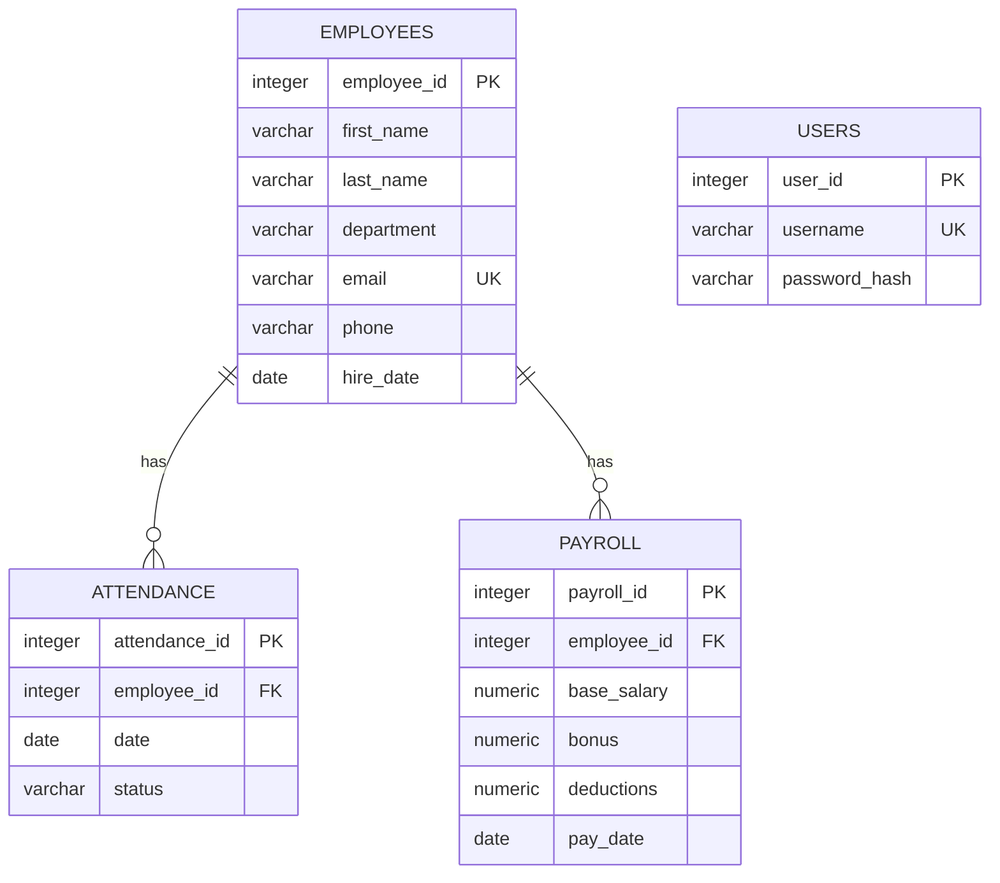

# Record Management System — Database Report

**Report date:** 15 October 2026  
**Database inspected:** PostgreSQL `record_management`  
**Observed server version:** PostgreSQL 18.4  
**Audience:** Developers, database administrators, project reviewers, and maintainers

---

## 1. Executive Summary

This report describes the database layer behind the Record Management System: its PostgreSQL configuration, four tables, fields, constraints, relationships, application queries, data flows, operational requirements, risks, and recommended improvements.

The database stores:

1. User account identifiers and bcrypt password hashes.
2. Employee identity and contact details.
3. Attendance dates and status values linked to employees.
4. Payroll amounts and pay dates linked to employees.

The live database was inspected without retrieving individual employee or payroll values. At the time of inspection it contained four public tables and had the following record counts:

| Table | Rows observed | Purpose |
|---|---:|---|
| `users` | 1 | Application accounts |
| `employees` | 3 | Employee master records |
| `attendance` | 2 | Attendance entries |
| `payroll` | 3 | Payroll entries |

Counts are a point-in-time operational snapshot, not a requirement or guaranteed future value. This project currently has no checked-in, versioned database migration set. A fresh environment therefore needs a reviewed schema setup process before the application can run.

### Overall assessment

**Good foundations:** primary keys, a unique username, unique employee email, employee foreign keys, an attendance status check, PostgreSQL connection pooling, and parameterized SQL values in routes.

**Important gaps to address:** database credentials are embedded in source configuration; attendance and payroll employee IDs currently allow `NULL`; payroll amounts have no non-negative checks or currency definition; there is no audit/history mechanism; employee deletion cascades into attendance/payroll history; and schema changes are not versioned as migrations.

---

## 2. Database Architecture and Connection

### Components

- **PostgreSQL:** persistent relational store.
- **Node.js `pg` Pool:** shared application connection pool exported by `db.js`.
- **Express routes:** execute SQL through the pool for registration, login, employees, attendance, and payroll.
- **React client:** does not connect directly to PostgreSQL; all data access goes through the authenticated HTTP API.

### Current local connection profile

The database module currently configures a local connection with:

- Database name: `record_management`
- Host: `localhost`
- Port: `5432`
- Database user: `postgres`
- Password: embedded in `db.js` (not reproduced here)

This is a developer-local configuration, not a safe production profile. Move all connection details into environment variables or a secrets manager before sharing or deploying the application. Rotate any real credential that may have been committed or shared. Use a dedicated database role with only the permissions the application needs instead of a database superuser.

### Pool lifecycle

`db.js` creates one PostgreSQL pool and exports it for route modules. This is a suitable simple application pattern. A production service should also configure and monitor pool limits, connection timeouts, idle timeouts, TLS where required, startup readiness, and graceful pool shutdown on process termination.

---

## 3. Entity Relationship Model



`USERS` is not currently related to employees or scoped records. Any account that has a valid token accesses the same shared employee, attendance, and payroll data. The `||--o{` relationship means one employee can have zero or many attendance/payroll rows; because the foreign-key columns are nullable in the inspected database, the database also permits a child row with no employee. The UI normally supplies a real employee, but the database should enforce that relationship more strictly.

---

## 4. Data Dictionary and Observed Rules

The following describes the live schema inspected on the report date. Integer IDs use PostgreSQL sequences (equivalent to `SERIAL`-style generation); primary key columns are not nullable. Actual schema definitions should be managed with migrations going forward.

### 4.1 `users`

Stores accounts used by login and signup.

| Column | PostgreSQL type | Null allowed? | Default / constraints | Meaning |
|---|---|---:|---|---|
| `user_id` | integer | No | Sequence-generated, primary key | Internal account ID |
| `username` | character varying | No | Unique | Login name; API accepts 3–64 characters after trimming |
| `password` | character varying | No | — | Bcrypt hash, not the original password |

The route uses bcrypt with a cost factor of 10. A successful login produces a signed JWT that expires after one hour. The application does not store the JWT in this table; it stores it in the browser. The field is named `password` but contains a hash; a future migration may rename it to `password_hash` for clarity.

### 4.2 `employees`

Stores employee master data.

| Column | PostgreSQL type | Null allowed? | Default / constraints | Meaning |
|---|---|---:|---|---|
| `employee_id` | integer | No | Sequence-generated, primary key | Internal employee ID |
| `first_name` | character varying | No | — | Employee given name |
| `last_name` | character varying | No | — | Employee family name |
| `department` | character varying | Yes | — | Department/team |
| `email` | character varying | No | Unique | Contact email |
| `phone` | character varying | Yes | — | Contact telephone number |
| `hire_date` | date | Yes | `CURRENT_DATE` | Hire date; not currently shown or submitted in the employee form |

The email unique constraint creates a unique B-tree index. The application inserts and updates first name, last name, department, email, and phone; the database fills the hire date default for a new row.

### 4.3 `attendance`

Stores a date and attendance status associated with an employee.

| Column | PostgreSQL type | Null allowed? | Default / constraints | Meaning |
|---|---|---:|---|---|
| `attendance_id` | integer | No | Sequence-generated, primary key | Internal attendance row ID |
| `employee_id` | integer | Yes | Foreign key to `employees.employee_id`; `ON DELETE CASCADE` | Employee associated with the entry |
| `date` | date | No | No default observed | Calendar date for the entry |
| `status` | character varying | Yes | Check: `Present`, `Absent`, or `Late` | Attendance classification |

The status check is case-sensitive as written. The current screen uses a free-text status field, so users must enter one of the accepted values with matching capitalization. Replacing that field with a dropdown would reduce avoidable insert failures.

There is no uniqueness constraint on `(employee_id, date)`, so the same employee can have multiple entries for the same date. Whether that is valid should be a business rule, not an accidental behavior.

### 4.4 `payroll`

Stores amounts associated with an employee and a pay date.

| Column | PostgreSQL type | Null allowed? | Default / constraints | Meaning |
|---|---|---:|---|---|
| `payroll_id` | integer | No | Sequence-generated, primary key | Internal payroll row ID |
| `employee_id` | integer | Yes | Foreign key to `employees.employee_id`; `ON DELETE CASCADE` | Employee associated with the entry |
| `base_salary` | numeric | No | No default observed | Base amount for this payroll row |
| `bonus` | numeric | Yes | `0` | Bonus amount |
| `deductions` | numeric | Yes | `0` | Deduction amount |
| `pay_date` | date | Yes | `CURRENT_DATE` | Pay date |

The database does not currently constrain amounts to non-negative values, specify currency, specify salary period, or enforce a unique payroll period. Those are important domain decisions before treating this data as authoritative payroll. PostgreSQL `NUMERIC` is an exact decimal type, which is preferable to floating-point storage for currency, but a chosen precision/scale and currency are still needed.

---

## 5. Constraints, Relationships, and Indexes

### Primary and unique constraints observed

- Primary keys: `users.user_id`, `employees.employee_id`, `attendance.attendance_id`, and `payroll.payroll_id`.
- Unique keys: `users.username` and `employees.email`.
- The corresponding primary-key and unique constraints are backed by B-tree indexes.

### Foreign keys observed

- `attendance.employee_id` references `employees.employee_id` with `ON DELETE CASCADE`.
- `payroll.employee_id` references `employees.employee_id` with `ON DELETE CASCADE`.

This prevents a non-null child employee ID from referring to a nonexistent employee. It does **not** prevent `NULL` employee IDs because both foreign key columns allow null. Cascading means a parent employee delete also deletes related attendance and payroll rows. This may be unsuitable for employment and financial history; an archive or restricted deletion policy is safer for many organizations.

### Check constraints observed

- `attendance.status` is restricted to `Present`, `Absent`, or `Late`.

### Indexes observed

- Primary-key indexes on the four ID columns.
- Unique index for employee email.
- Unique index for username.
- No additional indexes were observed on `attendance.employee_id`, `attendance.date`, `payroll.employee_id`, or `payroll.pay_date`.

Foreign-key columns and date columns may benefit from indexes as data grows or if common queries filter/order by them. Add indexes in response to measured query patterns and `EXPLAIN` plans, considering the write and storage cost of each index.

---

## 6. Database Operations Performed by the Application

All SQL is issued by the Express server through the shared pool. SQL values are passed as `$1`, `$2`, etc. parameters in the record routes and authentication queries. This helps keep user-provided values from being interpreted as SQL syntax.

| Feature | Database behavior |
|---|---|
| Register | Bcrypt-hash password, insert username/hash, return account ID and username only; unique violation maps to HTTP 409 |
| Login | Select user by username, compare submitted password with stored hash using bcrypt, sign JWT on success |
| Employee list | `SELECT * FROM employees` |
| Employee create | Insert first name, last name, department, email, phone; return inserted row |
| Employee edit | Update those fields by employee ID; return updated row |
| Employee delete | Delete by employee ID; linked child records cascade according to the database FK |
| Attendance list/create/update/delete | Select all; insert/update `employee_id`, date, status; delete by attendance ID |
| Payroll list/create/update/delete | Select all; insert/update employee ID, base salary, bonus, deductions, pay date; delete by payroll ID |

The API uses `SELECT *` for lists and currently returns all rows without pagination or ordering. For large tables, use explicit column lists, stable sorting, filters, and pagination. The employee and payroll/attendance routes return database error messages from the database layer in some failure paths; production APIs should return safe, consistent error responses and log internal details only on the server.

---

## 7. Integrity and Operational Observations

### What the database enforces today

- Every row has a generated primary key.
- Account usernames are unique.
- Employee email addresses are unique.
- Required employee names/email, attendance date, payroll base salary, and account fields cannot be null.
- Non-null attendance/payroll employee references must resolve to an employee.
- Attendance status must be one of three accepted strings.
- Deleting an employee cascades to linked attendance and payroll rows.

### What is mostly enforced by the UI/API today

- New user name and password length requirements are in the registration route.
- Attendance form dropdown selects an employee, but schema still allows a null employee reference.
- Attendance status form accepts free text, but the database allows only the three listed values.
- Payroll numeric format is constrained by HTML input and PostgreSQL type, but there is no server-side business validation for non-negative amounts or currency.
- Employee required fields are required in the form; the database enforces only first name, last name, and email.

Client checks improve usability; they are not a substitute for server and database constraints. Clients can be bypassed by direct API callers.

---

## 8. Database Setup and Configuration

### Database prerequisites

1. Install and start PostgreSQL.
2. Create a database named `record_management`.
3. Create the four tables with the expected columns, constraints, and sequences.
4. Configure the API connection to use a dedicated database role.
5. Install backend dependencies in the project root with `npm install`.
6. Start the API with `npm start`; the API uses port `5000`.

The working database on the inspected machine already contained the schema. There is no project SQL initialization or migration directory in the repository, so the example below is a **reference for a fresh empty database**, not a command to run against an existing database.

### Example initial schema

Review and adapt this schema before running it. It reflects the observed column-level shape and major constraints. Apply it only to a new/empty database, and preferably put equivalent DDL into a version-controlled migration system.

```sql
CREATE TABLE users (
    user_id SERIAL PRIMARY KEY,
    username VARCHAR NOT NULL UNIQUE,
    password VARCHAR(255) NOT NULL
);

CREATE TABLE employees (
    employee_id SERIAL PRIMARY KEY,
    first_name VARCHAR NOT NULL,
    last_name VARCHAR NOT NULL,
    department VARCHAR,
    email VARCHAR NOT NULL UNIQUE,
    phone VARCHAR,
    hire_date DATE DEFAULT CURRENT_DATE
);

CREATE TABLE attendance (
    attendance_id SERIAL PRIMARY KEY,
    employee_id INTEGER REFERENCES employees(employee_id) ON DELETE CASCADE,
    date DATE NOT NULL,
    status VARCHAR CHECK (status IN ('Present', 'Absent', 'Late'))
);

CREATE TABLE payroll (
    payroll_id SERIAL PRIMARY KEY,
    employee_id INTEGER REFERENCES employees(employee_id) ON DELETE CASCADE,
    base_salary NUMERIC NOT NULL,
    bonus NUMERIC DEFAULT 0,
    deductions NUMERIC DEFAULT 0,
    pay_date DATE DEFAULT CURRENT_DATE
);
```

### Configuration recommendations

Replace source-code values in `db.js` with environment-driven configuration, for example:

- `DB_HOST`
- `DB_PORT`
- `DB_NAME`
- `DB_USER`
- `DB_PASSWORD`
- `DB_SSL` (where deployment requires TLS)

Validate required configuration at process startup and fail clearly if it is absent. Keep a `.env.example` with placeholder names only; keep actual `.env` files out of version control. Rotate credentials that have ever been shared or committed.

---

## 9. Backup, Restore, and Data Lifecycle

No backup or restore automation is included in the application. The organization operating the database is responsible for creating and testing backups.

### Backup principles

- Establish recovery objectives: acceptable data loss window (RPO) and restoration time (RTO).
- Take scheduled backups using an approved PostgreSQL process (for example, `pg_dump` for logical backups, or managed-service snapshots).
- Encrypt backups at rest and in transit; limit access and document retention.
- Keep backups separate from the host that runs the app/database where feasible.
- Include schema, sequences, constraints, and data in recovery testing.
- Test restores periodically in a non-production environment. A backup that has never been restored is unverified.

Illustrative commands (adapt paths, authentication and retention policy; do not put passwords directly on the command line):

```sh
# Logical backup. Configure credentials using a protected PostgreSQL password file
# or another approved secret mechanism, not by embedding them in this command.
pg_dump --format=custom --dbname=record_management --file=record_management.backup

# Restore into a newly created, isolated test database for validation.
createdb record_management_restore_test
pg_restore --dbname=record_management_restore_test record_management.backup
```

Do not experiment with a restore against the live production database. Validate row counts and application behavior in a separate environment before relying on a recovery.

### Retention and deletion

Employee deletion currently triggers a database cascade into attendance and payroll. Before operational use, decide whether records must be retained, anonymized, archived, or deleted under applicable policy and law. Consider soft deletion or restricted deletion, and establish an auditable correction process for payroll data.

---

## 10. Security and Privacy Assessment

### Existing controls

- Passwords are hashed with bcrypt before insertion.
- Registration and login use parameterized SQL.
- Username uniqueness is enforced by the database.
- Employee/attendance/payroll API paths require a valid JWT at the Express layer.
- The JWT has a one-hour expiry.

### Database-specific risks and actions

1. **Embedded connection credential:** Current DB connection values, including a password, live in the source file. Move all of them into a secret manager/environment configuration and rotate any real credential that was exposed.
2. **Overprivileged database role:** Current user is configured as `postgres`. Production should use a least-privilege role limited to the required schema/tables, not a superuser.
3. **Null employee references:** Make attendance/payroll employee IDs `NOT NULL` if every record must belong to a real employee.
4. **Cascade deletion of sensitive history:** Assess whether cascade is lawful/appropriate. Use restricted deletes, archival, or audited retention if history must remain.
5. **No account-to-data ownership/roles:** All valid accounts can access shared records. Add authorization roles and least-privilege checks before multi-user production use.
6. **No audit trail:** Add an append-only audit mechanism for changes to employee, attendance, and payroll data, recording actor, action, record identifier, and timestamp while avoiding unnecessary sensitive payloads.
7. **Sensitive backups:** Payroll and employee data need encryption, strict access, retention, and restore testing.
8. **Database network access:** Restrict inbound database connections to trusted application hosts and administrators; do not expose port 5432 publicly.
9. **TLS:** Require encrypted client-to-database connections where crossing an untrusted network.
10. **Error handling:** Avoid sending raw SQL or database errors to public API callers; preserve diagnostics in protected logs.
11. **Data minimization:** Do not store extra employee or payroll fields unless there is a clear business purpose and retention rule.

This report is a technical review of the observed implementation, not a legal or regulatory compliance certification.

---

## 11. Performance and Scalability

At inspection time, data volumes were small (2 attendance, 3 employees, 3 payroll, 1 user). The existing indexes are sufficient for primary-key lookups and username/email uniqueness at this size.

As the database grows:

- Add pagination and predictable ordering to list endpoints rather than returning every row.
- Use explicit column lists instead of `SELECT *`, avoiding accidental exposure and reducing transfer size.
- Analyze common filters and joins; use `EXPLAIN (ANALYZE, BUFFERS)` only in a safe environment and with care on production.
- Consider indexes on `attendance(employee_id, date)` and `payroll(employee_id, pay_date)` if actual queries frequently filter by these values. A uniqueness rule on attendance employee/date or payroll employee/pay period should be added only after confirming requirements.
- Monitor connection-pool usage, query latency, locks, disk capacity, cache hit behavior, and slow queries.
- Plan table growth, vacuum/analyze, retention, and archiving based on observed usage.

Indexes improve reads but consume disk and add work to inserts/updates/deletes, so confirm them with a representative query plan.

---

## 12. Recommended Database Roadmap

### Priority 0 — Before deployment beyond a local learning environment

- Remove credentials from `db.js`; configure secrets outside source control and rotate exposed values.
- Use a dedicated least-privilege PostgreSQL role.
- Configure production TLS, restricted network access, backups, restore drills, and monitoring.
- Set a strong externally managed JWT secret and coordinate its rotation.
- Establish authorization roles because current accounts share the entire dataset.

### Priority 1 — Data correctness

- Add migration tooling and commit a baseline migration for the observed schema.
- Make attendance and payroll `employee_id` non-null if the business rule requires an employee.
- Make attendance status a controlled UI selection and validate the enum on the server.
- Decide and enforce duplicate attendance and payroll-period rules.
- Define currency, amount precision/scale, non-negative rules, and payroll periods.
- Decide whether deleting employees should cascade, be restricted, or archive data.

### Priority 2 — Operations and governance

- Add audit events, retention policy, data correction workflow, and administrative account lifecycle.
- Add read/write transaction boundaries where multi-step changes require atomicity.
- Add paginated queries, measured indexes, health checks, backup alerts, and restore procedures.
- Add automated database integration tests that run against an isolated test database and verify constraints, authorization, and migrations.

---

## 13. Verification Checklist for Database Changes

Before releasing a schema or database code change:

- [ ] The migration has been tested against a clean database and a copy of the previous schema.
- [ ] A current backup exists and its restore has been tested if the change is destructive.
- [ ] Primary keys, foreign keys, unique constraints, defaults, nullability, and check constraints match written requirements.
- [ ] API inserts, updates, deletes, and error paths were exercised with valid and invalid data.
- [ ] Authorization prevents unauthenticated access and respects intended roles.
- [ ] Sensitive fields are not returned unnecessarily; password hashes are never exposed in API results.
- [ ] Query plans and indexes have been reviewed for important high-volume paths.
- [ ] Data retention, deletion, and audit effects have been approved.
- [ ] Rollback or forward-repair steps are documented.
- [ ] Production secrets and connection permissions were verified without placing secret values in logs or source control.

---

## 14. Glossary

- **B-tree index:** PostgreSQL's general-purpose ordered index type, used here for primary keys and unique keys.
- **Cascade delete:** A foreign-key action that automatically deletes child rows when a referenced parent row is deleted.
- **Constraint:** A database-enforced rule that rejects invalid data.
- **Foreign key:** A relationship rule requiring a child value to match an existing parent row (unless the child value is nullable and is `NULL`).
- **Migration:** A versioned, repeatable database schema change tracked alongside code.
- **Pool:** A reusable set of database connections managed by the application.
- **RPO:** Recovery Point Objective; the maximum acceptable time/data gap after a failure.
- **RTO:** Recovery Time Objective; the target time to restore service after a failure.
- **Sequence:** A PostgreSQL number generator used to assign IDs.

---

## 15. Report Conclusion

The current database is a compact relational design that supports the implemented account, employee, attendance, and payroll workflows. It has useful identity, uniqueness, foreign-key, and status checks, and the application uses parameterized SQL for user values. Its current shape is appropriate as a local prototype or educational application with modest data volume.

Before production or real HR/payroll use, the most important database work is to externalize and rotate credentials, move away from a superuser account, establish migrations and backups, decide retention/cascade behavior, tighten nullable foreign keys and business rules, introduce role-aware authorization/auditing, and test restores and access boundaries. Payroll figures should not be treated as calculated or payable amounts without formally defined policy and a validated calculation workflow.
